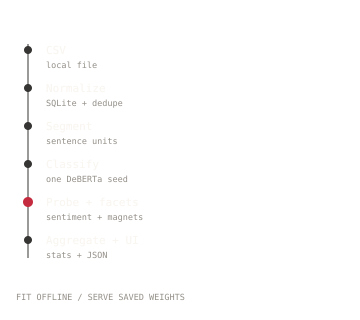

# Aspect-Based Hotel Review Analysis

A local single-property tool that turns one hotel's review CSV into category
counts, negative share, and sentence-level facets with the mention behind each
facet. The page asks for a CSV in the browser, runs the pipeline locally, and
replaces the current batch. A separate static showcase in `docs/` shows ten
cached reviews and lets a reader open each review's categories, sentiment and
facets.

## Architecture



One CSV goes through normalize (SQLite + dedupe), sentence restore, the category
model, the sentiment probe with magnet routing, then aggregate and the dashboard
data build. The same pipeline writes the cached showcase.

**Fit versus serve.** The classifier and the sentiment probe are fitted offline.
The service loads saved weights and thresholds. The browser
import runs the same local pipeline that the CLI runs.

## Quickstart

```bat
git clone https://github.com/YoussefHarrabii/Aspect-Based-Hotel-Review-Analysis.git
cd Aspect-Based-Hotel-Review-Analysis
python -m venv .venv
.venv\Scripts\activate
pip install -r requirements.txt
run.bat
```

`run.bat` opens a pywebview window and falls back to the browser. It uses the
local `.venv` when it exists.

Classifier weights live outside git. Put the published files in `models\cat`, or set
`REVIEWS_MODEL=hf:your-account/deberta-review-categories` before starting. The
first import downloads `intfloat/multilingual-e5-large-instruct` into the Hugging
Face cache.

On a fresh dataset the page starts on the import panel. Drop a CSV or choose a file. For a sample:

```bat
python scripts\make_sample_data.py
```

Then import `data\sample\reviews.csv` in the page. The sample writes 400 synthetic
rows for one property; exact-duplicate dedupe may leave slightly fewer.

## Data contract

One UTF-8 CSV, one property per file, with this header:

| column | required | rule |
| --- | --- | --- |
| `review_id` | yes | unique within the file |
| `date` | yes | empty, or `YYYY-MM-DD` |
| `rating` | yes | empty, or an integer 1 to 5 |
| `text` | yes | may be empty for a rating-only row |

```csv
review_id,date,rating,text
r-0001,2025-06-14,4,"The room was clean and the staff were helpful."
```

Extra columns are ignored. The import rejects a missing column, a blank or
duplicate `review_id`, a non-ISO date, or a rating outside 1 to 5, and names the
row number. Identical review text is dropped, and near-duplicates are dropped at a
high token-overlap threshold. The dataset lives under `data/`, which git ignores
and the first import creates. The full contract is in
[`docs/data-schema.md`](docs/data-schema.md).

## What the page shows

- Review count, average rating, and negative / neutral / positive mention counts.
- A ledger and category grid with mention counts and negative share.
- A category accordion. Each facet row shows the facet name, its count, and the
  top mention for that facet with rating and date. The page shows one mention per facet.
- `General Experience` is a catch-all facet and appears in its own block below
  the specific facets.

`Location` is treated as an `Other` catch-all. It stays in the saved checkpoint
for label order but is not propagated to aggregation or either UI.

The app is single-property. Import a batch through the page; the overview is the
working view.

## Static showcase

`docs/` is a self-contained GitHub Pages site. It reads
`docs/data/showcase.json`, which is rebuilt from a local review CSV by:

```bat
python scripts\build_showcase.py
```

The CSV stays under `data/showcase/`, which git ignores; the committed cache is
the only showcase data in the repository. The ten rows are the production
showcase reviews: two per star rating, one clean English and one non-native
English.

GitHub Pages settings: deploy from the `main` branch, folder `/docs`.

The showcase has a short method band below the ten reviews. The detailed pages are:

- [`docs/method.html`](docs/method.html): stages, fit versus serve, mention anatomy.
- [`docs/facets.html`](docs/facets.html): the facet-routing benchmark.
- [`docs/latency.html`](docs/latency.html): per-stage timings.
- [`docs/decisions.html`](docs/decisions.html): decisions and limits.

Diagrams are hand-authored SVGs in `docs/assets/diagrams/`, using the same hairline, mono-label and single-accent rules as the rest of the UI.

## Model provenance

The classifier is a DeBERTa-v3-base fine-tuned on hand-labelled public reviews from hotels in the same region, and scored on a held-out property that was absent from training. The training corpus and the evaluation gold set are not released. The reported score is therefore not independently reproducible from this repository.

## Model, thresholds and score

The shipped classifier is a single seed, `cat_v5c_s2`.
Per-label thresholds are applied to each sigmoid independently; `Location` is
present in the checkpoint but excluded from the score and from the dashboard. The
thresholds are listed in [`docs/model-card.md`](docs/model-card.md).

On the held-out property the shipped seed scores **category-macro F1 0.890**
(micro F1 0.883). The spread across the three measured seeds is **0.025**
category-macro F1.

Classifier weights are not in git. The float32 checkpoint is 737,734,660 bytes
(703.6 MiB); the shipped fp16 file is 368,879,606 bytes (351.8 MiB).
`scripts/to_fp16.py` does the conversion and reports both sizes.

## Design

Both pages use the attached Griffin Pomegranate design reference: near-black canvas,
cream type, hairline rules, one pomegranate accent, serif display over mono data.
The fonts are open-source OFL files vendored with the repo: Newsreader, Inter and
IBM Plex Mono. Their license texts are in `app/web/fonts/`. Motion is limited to the load set, drawn rules, row reveals and the
accordion; it is disabled under `prefers-reduced-motion`.

`config/magnets.json`, `config/buckets.json` and `app/pipeline/cat_rules.py` are
example hospitality sets. The production bucket set was tuned for a particular
taxonomy. A user replacing the categories, magnets or rules should author their
own; the rule engine and data structures stay the same.

## Experiments

Facet routing was benchmarked on a hand-labelled gold set: 1,075 sentences (482 dev / 593 fresh), 38 buckets, 6 categories. The current e5 + max-magnet router leads on the held-out fresh split at **0.922 top-1 coverage / 0.937 bucket coverage**. Linear SVM reaches 0.823 coverage, logistic regression 0.801, the magnet centroid 0.809, kNN 0.730, TF-IDF 0.653; clustering and topic models are below 0.59.

`scripts/eval_facets.py` runs the comparison. The gold file and the production magnet bank are external and are not released. `scripts/timing.py` measures the local pipeline at 10, 100 and 377 reviews. On the current GPU the 377-review import takes about **48.1 s**; a warm `/api/data` call is about **12 ms**. The stage table is in [`docs/latency.html`](docs/latency.html).

## Training files

`training/train_cat.py` is the category-only trainer.
`training/shared.py` holds the data loading, threshold tuning and metrics that
`train_cat.py` and `fit_probe.py` import. `training/fit_probe.py` refits the
sentiment probe on a local corpus. None of them runs on the sample CSV; they need
the unreleased training corpus and a local DeBERTa base.
`training/ensemble_eval.py` was left out because it requires the three seeds and
the unreleased corpus.

## Tests

```bat
pytest -q
python -m pytest tests\test_pipeline_smoke.py -s
```

The smoke test runs CSV to mentions to `data.json` with deterministic local fakes
for the classifier, e5 encoder and probe, so it runs offline. GitHub Actions runs
the same suite on every push and pull request (`.github/workflows/ci.yml`). The
seed comparison needs the external gold file:

```bat
set REVIEWS_GOLD=C:\path\to\gold.jsonl
set REVIEWS_SEED_DIRS=C:\path\to\seed1;C:\path\to\seed2;C:\path\to\seed3
python scripts\pick_seed.py
```

The gold file is external to this repository. Its path belongs in the local
environment.

## Limitations

One property per batch. One hospitality domain. English only.
Classification is sentence-level, so a sentence spanning two topics can produce
two mentions. Sentiment is a sentence-level logistic probe; the neutral band is a
fixed 0.10 around 0.5.

## Licence

Code: MIT, see [`LICENSE`](LICENSE). Training-data rights sit with the review
platforms and the authors of the reviews. The weights are published separately for
use with this code; the training corpus is not released.
